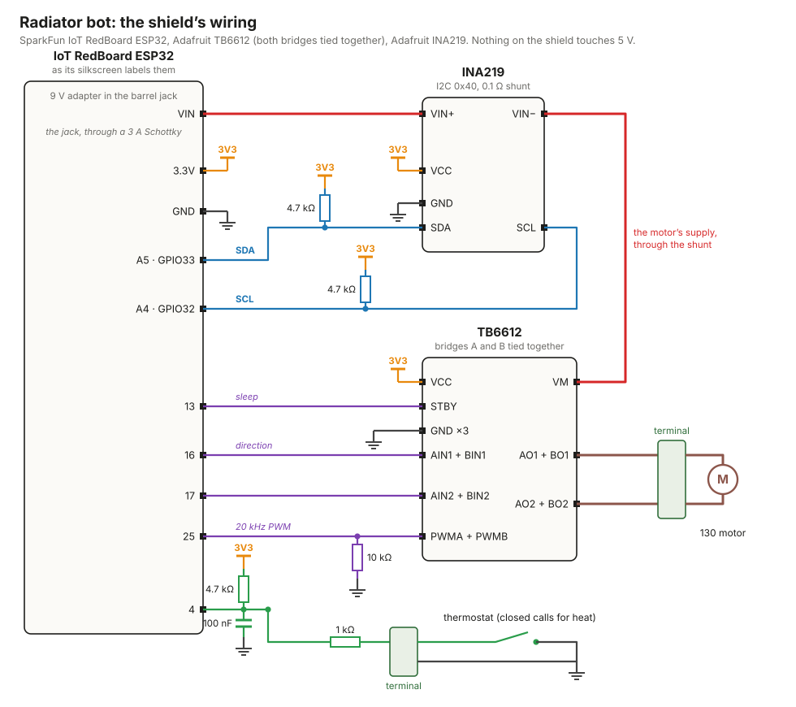

# Radiator bot: mechanical design

A gearmotor that clamps to the radiator valve's supply pipe and turns the star handle. A 130 motor
drives a stack of three printed planetary stages with helical teeth, which turns a socket round the
handle through two slow spur meshes. The motor's
current says when the stem reaches either end of its screw. A SparkFun IoT RedBoard ESP32 reads
an old dry-contact thermostat and runs the motor through an Adafruit TB6612 H-bridge, on a
perfboard shield plugged into it. An INA219 current monitor in the driver's supply tells it when
the motor stalls. A 9 V wall adapter in the RedBoard's barrel jack powers it all, and its Wi-Fi
puts the bot on the home network, for a phone.

Everything is FDM-printed except the drill rod the gears turn on, the planets' steel pins and the
screws. The model is
`radiatorbot.sv`. The valve it fits is `radiator_valve.sv`, and the parts libraries are
`gears.sv`, `motor130.sv` and `boards.sv` (the RedBoard, its shield, the motor driver and the
current monitor).

## How it works

The bot hangs on the valve's −y side, beside the outlet. Seen from below, looking up at the
handle, it stands a quarter turn clockwise from where it hung before, off the outlet's far end
(−x). `radiatorbot.sv` lays the bot out in a frame of its own, `bot`, turned `bot_turn` (90°)
about the stem. Its x runs out from the stem through the clamp's split, and the bot hangs on its
−x side. Directions below (the bay's −y half, the driver toward +x) are that frame's.

- **The socket** is a 64-tooth gear (module 1.364) round the handle, turning about the stem
  with it. Its middle is a hole the shape of the handle's top face, grown 0.3 mm all round,
  straight from its floor up out of its top. The handle turns it 1:1, all four arms at once.
  - The stem screws the handle 7.21 mm down over its three and a half turns, as measured (the
    bare stem under the packing nut opens from 4.38 mm to 11.59 mm). `radiator_valve.sv` draws
    the handle on a screw along its stem, 2.06 mm a turn. The socket stays where it is, and the
    handle screws up and down through its hole.
  - The arms' 8° draft leans them in toward their bottom face, so each arm is widest at its top
    edge. The socket's top stands 1 mm over the handle's top face when it's closed, and its hole
    runs on down past where the handle stands open. So every arm's top edge is always in the
    hole, 0.3 mm off its wall, and that edge, the straight length of each arm's side, drives.
  - The arms' play in the hole is ±0.5° of the handle, and each arm is driven near its tip.
  - Under the open handle's bottom face the socket has a 4 mm floor. It turns on a pad on the
    stem's axis at the end of the **stand**, an arm clamped to A under its pinion.
  - The pivot is a 6 mm pin printed up from the pad into an 8 mm blind hole in the floor's
    middle. The pin keeps the pad under the socket and the socket over the pad.
  - The pin is 1 mm loose all round on purpose. The handle centres the socket to 0.3 mm, and the
    pin never fights it for the centre, however the stand is set. The pad only bears the
    socket's weight.
- **A** is a fixed ½ in axle 60 mm from the stem. A's compound turns on it: a 24-tooth pinion
  driving the socket, and over it a 48-tooth ring (module 1.5) driven by the stack's pinion, one
  print. The upper collar over the ring and the stand under the pinion keep it in place.
- **The planetary stack** stands on P, the motor's axis, 45 mm from A where the motor stood beside
  the boards. It is three like stages, each a 17-tooth sun, three 19-tooth planets and the
  55-tooth ring round them, under the motor:
  - The first sun is pressed on the motor's shaft. Each carrier is a plate with the next stage's
    sun under it, one print, and the last carrier has the 12-tooth spur pinion (module 1.5) under
    it instead, which drives A's ring.
  - Every carrier turns on a fixed 4 mm rod, P, pressed into the base's floor. The motor's shaft
    runs on down into the first carrier's bore, a millimetre past the rod's top.
  - Each plate holds its stage's planets on 3 × 10 mm steel dowel pins pressed 4 mm into it. A
    planet runs 0.3 mm over its plate and 0.3 mm under the next carrier's, which keeps it on its
    pin.
  - The ring is one internal gear, the **barrel**, up through the base round P: all three stages'
    planets run in its one band of teeth, so each carrier, its planets on, screws down the barrel
    into place from the top.
  - The teeth are helical, 25°: the suns left-handed, the planets and the barrel right-handed.
    See *The drive* for why.
- **The keeper** is the gearbox's lid, a print of its own pressed down into the top of the base:
  it holds A's top and the motor, so the base, the keeper and the motor are a whole gearbox
  without the frame.
  - It's a frame of beams 6 mm wide and 3 mm deep, open between them, rather than a sheet: a
    spine from end wall to end wall through the stack and A, over the bridge, and a cross beam
    over the bulkhead from side wall to side wall. Over the stack the spine runs through a round
    plate the motor stands on. It stands on the bridge, the bulkhead and the barrel's top.
  - The motor's front boss presses into a recess in its pad, 0.05 mm over its size (`snug`), so
    the motor's shaft, and the first sun on it, stand on P's axis as truly as the rails stand the
    keeper in the base.
  - Only its four beams' ends touch the base's walls, each a pad 14 mm along its wall and 6 mm
    deep. Up the middle of each wall's inside face where a pad meets it stands a **dovetail
    rail**, 5 mm across at the wall, its flanks 15° off square like the mount's joint, standing
    3 mm out. Each pad has the rail's slot through it, the rail grown 0.05 mm all round (`snug`):
    the keeper slides straight down over all four, a light press on the flanks. The rails hold
    each pad to its wall and square along it, so the keeper can neither spread nor pull in off
    the walls.
  - Each rail runs from the base's top down to its foot, which slopes off the wall at 45°, full
    depth at the keeper's underside, so the base prints it without support. The end rails stand
    over the bridge and the far end wall, the side rails over the bulkhead's ends.
  - The base's walls run up 3 mm past the gears to the keeper's top, and its four corner posts
    with them, beside the keeper and clear of it.
  - On it: A's post, and the motor's pad and cradle on the plate, the motor face down in it, the
    can's flats keying it against its torque.
  - Every beam runs into its hub, the plate or its pad through a 3 mm fillet in plan, filleted
    the beams' depth only, so none reaches up to the frame's floor or down to the gears.
  - **The motor's strap** holds it down on its pad, the usual way to hold a 130 that has no
    screw holes in its face: a printed bar 2.4 mm thick across its end bell, the end bell's boss
    up through a ring in it, and a leg down each side past the flats onto an **ear** up from the
    cradle's flat wall. A countersunk M3 through each leg self-taps into its ear. The ears stand
    0.5 mm short of the legs, so the screws always draw the strap down onto the end bell, never
    onto the ears. The bar is 8 mm wide, across the flats' middle, clear of the terminal tabs at
    the round sides.
  - The ears swell from the cradle's 2.4 mm wall to 6 mm over a 45° underside, which starts 7 mm
    over the RedBoard's underside, clear of its edge beside the cradle and of its LiPo socket,
    which the +y ear passes over.
- **The frame** is one print: the electronics bay (the boards beside the motor) on a 2.4 mm floor
  of its own, standing on the base's walls and the keeper, with a dovetail rail up the outside of
  its end wall toward the valve. Its floor has a hole round A's post on the keeper and round
  the cradle, its ears and the strap, 0.3 mm clear, so it goes down over the keeper with the motor
  strapped in. The base's four screws pass down through its floor into the base's corner posts,
  and its floor bears down on the keeper's beams, holding it on the bridge and the bulkhead.
  - The screws stand 6.2 mm in from the box's outside, so their pan heads (5.6 mm across) sit on
    the frame's floor 1 mm clear of the bay's walls. The posts under them are 8.6 mm across,
    reaching out into both walls. The RedBoard stands 1.2 mm over the head in its corner; fit
    these four screws before the RedBoard.
- **The mount** is a print of its own, snapped and glued onto the frame's rail: a spine up beside
  the valve to the **clamp**'s fixed half. Split off, each part prints without support: the frame
  on its floor, the mount on its top.
  - The rail is 12 mm across at the wall, its flanks 15° off square, standing 5 mm out. The
    spine's slot is the rail grown 0.15 mm all round, room for the glue, open at the spine's top
    and closed at its foot by a shelf, the mount's foot flush with the frame's underside. The mount
    slides up onto the rail from below until the rail's foot sits on the shelf, so the frame
    hangs on it.
  - The rail's foot leaves the wall 2 mm up from the frame's underside and slopes up and out at
    45°, so the frame prints it off the wall without support; the shelf under it slopes the same
    way, and so prints as a 45° ceiling in the mount rather than a bridge. The slope presses the
    rail's flanks into the slot's.
  - The snap holds the two together while the glue sets. A finger 1.6 mm thick, 6 mm wide and
    20 mm long hangs in the slot's floor with a slit round it and a 1 mm relief behind it. The
    barb at its foot stands 0.6 mm into the slot, square underneath and ramped over. In the last
    few millimetres the rail's lip pushes it out, and then it drops into a notch in the rail's face.
    The finger runs along z, so it prints standing up rather than as an overhang.
  - The dovetail's flanks take the handle's reaction sideways and outward, and the glue takes the
    rest.
  - The clamp is a block split at the stem, round the valve's inlet hex and the supply pipe above
    it. The fixed half is the mount's; the cap closes it from the side away from the bot (the
    valve's +y), out of the radiator's way, with four M4 bolts whose nuts sit in pockets in the
    fixed half's back.
  - The hex pocket takes the handle's reaction torque positively; nothing relies on friction on
    a round pipe.
  - The hex has a flat square to the outlet, so the split crosses the middles of two flats: each
    half holds two whole flats and half of each of those, with a corner in its middle.
  - Both rows of bolts grip the pipe above the hex. The lower row clears the hex's pocket by about
    3 mm, and at least 1 mm is claimed.
  - The clamp is 48 mm across, so its radiator-side face reaches out over the outlet's union nut
    (18.5 mm from the stem, 18.8 mm thick), whose top stands above the hex's underside. Both
    halves are relieved round the nut, its hex grown 2 mm all round.
- **The base** is the gearbox's floor and walls, screwed up to the frame. Its
  floor stops short of A's ring, and a bridge holds A's axle, standing on the upper collar just
  above the ring.
  - The bridge runs from A out to the end wall. That wall stops over the ring, so on its own it
    is a thin plate that flexes under the bridge. A **bulkhead** 4.8 mm thick runs across the
    whole box through A, from just over the ring's room up to the keeper, 0.3 mm clear round the
    collar, so the bridge is tied into both side walls as well as the end wall. The keeper's
    cross beam lies along its top, pressed against both side walls.
  - The **barrel** stands up from the floor round P into the −y wall, up to the keeper. Its teeth
    run from the last carrier's plate up past the first stage's planets; under them is its plain
    bore, where the last pinion turns and A's ring comes in through the ring's room, and over them
    the keeper's plate, which stands on its top.
  - The box's −y side moved out 11 mm to take the barrel (it was 31 mm off A's line, and is
    42 mm).
- **The rods' seats.** Each rod is pressed into the housing, not just through a plate, so it is
  held square over a length rather than pivoting in a thin wall:
  - A's axle stands in the bridge, which runs from the upper collar all the way up to the
    keeper's underside, and up into a post on the keeper's top, 2.5 mm tall, its hole blind
    under a 1 mm roof. The post comes up through the frame's floor, 0.1 mm proud of it.
  - P's rod stands in the 6 mm floor; the last pinion runs on the floor just over it, so there's
    no room for a post there. The carriers find their own centres among their planets too, so
    the rod mostly takes their tilt.

## The drive

| stage | teeth | module | axis | ratio |
|---|---|---|---|---|
| 1 | sun 17, planets 19, ring 55 | 0.8 normal, 25° helical | motor → carrier 1 (P) | 4.24 |
| 2 | sun 17, planets 19, ring 55 | 0.8 normal, 25° helical | carrier 1 → carrier 2 (P) | 4.24 |
| 3 | sun 17, planets 19, ring 55 | 0.8 normal, 25° helical | carrier 2 → carrier 3 (P) | 4.24 |
| ring | 12 → 48 | 1.5 | P → A | 4 |
| socket | 24 → 64 | 1.364 | A → handle | 8⁄3 |

**Why it was loud, and what's quieter.** The spur train's first stages turned fast: the motor's
12-tooth pinion at 13 500 rpm into module 0.8 spur teeth, each tooth slapping into mesh across its
whole face at once, about 2 700 times a second, in four spur meshes on overhung compounds whose
centres the rods only roughly held. The stack replaces the four fast spur meshes:

- **Helical teeth.** Each tooth comes into mesh gradually, from one face across to the other, and
  at 25° a 6 mm planet's face overlaps a whole pitch (a face contact ratio of 1.01), so one pair
  of teeth is always in full contact and the load never steps from tooth to tooth. A helical
  gear runs markedly quieter than a spur gear at the same speed.
- **Load shared.** Three planets share each stage's torque, so each tooth carries a third of what
  a spur pinion would, and deflects and slaps less.
- **Held true.** The stack is coaxial: every carrier turns about one rod and the barrel is one
  print round them, and each carrier also finds its centre among its three planets. The fast
  meshes no longer depend on several rods' holes in two prints agreeing.
- **Slow spur meshes kept.** A's ring and the socket's teeth stay spur: the stack's pinion turns at
  about 180 rpm and A at 45, where spur teeth are quiet, and a helix on the socket would push it
  up and down the handle.

Each stage is the same: (17 + 55) / 3 is whole, so three planets spaced evenly mesh the sun and
the ring together. At 25° a 17-tooth sun is generated without undercut (a 14-tooth one undercuts,
and Solvent's helical cut refuses a flank that folds back), so no tooth is shifted and the stack's
centre distances are nominal: P to each planet 15.89 mm. The last pinion is profile-shifted
+0.3 against undercut and A's ring −0.3, so P–A stays 45 mm and A–stem 60 mm.

That is 304:1 from the motor to A and **810:1 from the motor to the handle**, where the spur train
was 1024:1. The motor's figures are measured on the bench at the 9 V the firmware gives it
(`motor130.sv`): 13 500 rpm free and 6.9 mN·m stall, at 1.2 A. Each printed mesh is taken at
about 0.9. A planetary stage with its ring fixed loses only on the power its meshes roll through,
the sun turning against the carrier: (1 + 0.9² × 3.24) / 4.24 = 0.855 of it reaches the carrier.
With the ring's and the socket's spur meshes after, and the handle in the socket a direct drive,
that gives:

- **16.6 rpm free at the handle**, so three and a half turns of travel take about 16–24 s under
  load (the spur train's 13.2 rpm took 20–30 s);
- **2.83 N·m at the handle at stall**, 75 % of the spur train's 3.75 N·m; 1.18 N·m at A.

At 6 V the same motor would give 8 700 rpm and 4.7 mN·m: 1.9 N·m at the handle, too little
margin. Its winding is 7.5 Ω, so at 9 V it stalls at 1.2 A, well inside the driver.

The motor turns the same way for a handle turn as it did with the spur train: between the motor
and A there is now one external mesh (P's pinion on A's ring), the three stages each keeping the
direction, where the spur train had five. The firmware sets
which way is open when it's commissioned (`motor_invert`, in [firmware/README.md](../firmware/README.md)),
so a bot already commissioned keeps its setting.

`radiatorbot.sv` states the requirements as claims, which every check judges: stall torque
≥ 2 N·m at the handle, and between 70 % and 80 % of the spur train's; free speed ≥ 6 rpm; the
ring's tooth count (sun + 2 planets) and the even spacing of the planets; and a wall of at least
1.5 mm between each sun's and planet's roots and its bore. Read any figure back in its unit, for
example `solventc hardware/radiatorbot.sv --where handle_stall_torque`.

The current trip sets the torque that actually seats the valve. Set it with the valve in hand,
well under stall. Another motor's figures differ: measure it on the bench with
[firmware/tools/bench.html](../firmware/tools/bench.html) (its speed against its voltage, heard,
and its stall), put them in `motor130.sv`, and the figures and claims follow.

## The electronics

A SparkFun IoT RedBoard ESP32 stands beside the motor with a cut-down 5 × 7 cm perfboard shield
plugged into it, and two bought boards and two screw terminals soldered to the shield. All are
modelled in `boards.sv`, from their makers' layouts, and placed in the bay in `radiatorbot.sv`.

| board | what it does | price | where |
|---|---|---|---|
| [SparkFun IoT RedBoard ESP32](https://www.sparkfun.com/products/19177) (WRL-19177) | the controller: Wi-Fi, barrel jack 7–15 V, its own 5 V and 3.3 V, USB-C | ~$30 | SparkFun, Digi-Key |
| [Adafruit TB6612 breakout](https://www.adafruit.com/product/2448) (#2448) | two H-bridges of 1.2 A, 4.5–13.5 V, tied together here as one of 2 A | $5 | Adafruit, Digi-Key |
| [Adafruit INA219 breakout](https://www.adafruit.com/product/904) (#904) | high-side current and voltage over I2C, 0.1 Ω shunt, ±3.2 A | ~$10 | Adafruit, Digi-Key |

**Why these.**
- The RedBoard takes the wall adapter itself. Its barrel jack takes 7–15 V through a 3 A
  Schottky diode (B340A) to its VIN pin, and to the LM1117 that makes the board's 5 V, from which
  a 700 mA regulator makes its 3.3 V. The driver runs off VIN, so one adapter powers everything.
  - Its sockets and its four M3 holes are the Uno's, so a shield made for an Uno's sockets plugs
    in. The board itself is 0.1 in wider each side, 2.7 × 2.3 in: the bay is 2 mm wider for it.
  - Its ESP32 has Wi-Fi: the bot's console is on the network as well as on the USB-C, and it
    serves a page for a phone (see [firmware/README.md](../firmware/README.md)).
  - Its USB-C, through a CH340C serial bridge, gives programming and the console, and powers the
    board alone (not the motor).
  - **It's 3.3 V logic, and no pin takes 5 V.** Everything on the shield runs off its 3V3.
  - Its silkscreen labels its digital pins by their GPIO (4, 13, 25…) and its analog ones by
    their ADC channel, not by the Uno's places: its analog socket reads A5, A4, A7, A6, A3, A0
    (GPIO33, 32, 35, 34, 39, 36), and the last four are input only.
  - Its I2C pins, GPIO21 and GPIO22 (labelled SDA and SCL), aren't on the analog socket as an
    Uno's are. They're on its Qwiic socket, whose mouth faces the bay's end wall 3 mm away, and on
    the SCL–26 socket, off the shield's grid. The ESP32 puts I2C on any two pins that drive, so
    the INA219 is on the analog socket's first two, A5 and A4 (GPIO33 and GPIO32).
  - The linear 5 V regulator turns the adapter's extra volts to heat: about 0.4 W at 9 V with
    the Wi-Fi up, twice that at 12 V. 9 V is the adapter to use.
  - The Uno R4 Minima the bot had before had no Wi-Fi.
- The TB6612 is the H-bridge. Adafruit publishes its Eagle layout, which the model is taken from:
  a 19.05 × 26.67 mm board on two rows of pins 0.6 in apart, 10 of supply and logic and 6 of the
  outputs.
  - **Its two bridges are tied together**, input to input and output to output, as one bridge of
    twice the current. Each is rated 1.2 A, and every move ends in a stall: the 130 stalls at
    1.2 A at 9 V. Paralleled, the chip's rated about 2 A continuous, which is what Pololu
    recommends for a motor that stalls. The three logic pins drive both bridges at once.
  - Its motor supply takes 4.5–13.5 V (15 V at most), so the adapter stays at 12 V or under. The
    firmware scales the PWM to the supply the INA219 reads, so the motor sees 9 V on average
    (`motor_volts`): all of a 9 V adapter, three quarters of a 12 V one. Its speed and stall
    current are 9 V's whatever the adapter, but for a 9 V adapter's sag under load.
  - **It has no current limit**, only a thermal shutdown. The firmware's trip is all that stops
    a stall, so it takes trips of 2 A at most: a trip over the stall would never trip, and the
    motor would stall on to the move's timeout.
  - It has no current output. That's what the INA219 is for.
  - IN1 high and IN2 low drives one way while the PWM input is high, the other way with them
    swapped. PWM low, or both inputs high, brakes; both low coasts. STBY low sleeps the chip, its
    outputs off; the breakout pulls it up.
  - A 10 kΩ on the shield pulls the PWM input down, so while the ESP32 boots, its pins
    floating, the bridge can only brake or coast.
  - Its logic takes 2.7–5.5 V, and runs off the RedBoard's 3V3.
- The INA219 sits in the driver's supply, on the high side. It reads the current through its
  0.1 Ω shunt over I2C, ±3.2 A.
  - Reading on the high side keeps the driver's ground the RedBoard's.
  - It reads the supply's voltage as well. The firmware scales the PWM by it, and calls a move a
    motor fault if the adapter is unplugged, sags under 6.5 V, or is over the TB6612's 13.5 V.
  - A 12-bit conversion takes 532 µs, which averages over ten periods of the 20 kHz PWM.
  - It carries the driver's whole draw: the motor's current while the bridge drives, plus the
    chip's few mA. Under the PWM that reads about the PWM's fraction times the motor's current
    (a stall reads about 1.2 A off a 9 V adapter, 0.9 A off a 12 V one), and the firmware divides
    the fraction back out. The
    currents the console shows, and the trips, are the motor's own.
  - It runs off the RedBoard's 3V3, so its 10 kΩ pull-ups hold I2C at 3.3 V. Two 4.7 kΩ on the
    shield stiffen them for 400 kHz.
  - Its STEMMA QT sockets go unused, and so does its screw terminal: VIN+ and VIN− are on its
    pins too.

**The thermostat** is an old two-wire heating thermostat: a mercury switch on a bimetal coil, or
a bimetal snap switch, the kind on the wall of a house built in the 1960s or 70s, or out of
architectural salvage. It's a dry contact that closes on a call for heat. It makes no voltage of
its own: in the house it came from, the boiler's 24 V transformer or a standing pilot's thermopile
drove its loop. Here the RedBoard drives it.
- Its two wires go to a screw terminal on the shield: one to ground, one to pin 4 (GPIO4)
  through 1 kΩ. A 4.7 kΩ resistor pulls it up to 3.3 V and a 100 nF capacitor holds it to
  ground. The contact closed reads low.
  - The resistors and the capacitor are for the wire's length: they keep noise and a static spark
    off the pin. The 0.7 mA through the contact is plenty for mercury, which doesn't tarnish.
  - The firmware acts on a state only once it has held for 3 s, so a bounce as the mercury rolls,
    or the thermostat's own chatter, never runs the motor.
- Its heat anticipator, a small adjustable heater in series with the contact, sees only that
  0.7 mA, so it never warms. The thermostat then swings a degree or two wider than it would on a
  boiler. A radiator is slow enough not to mind. Its setting doesn't matter.
- Mount it level, as it was on the wall: a mercury switch works by tilting. If its bulb ever
  breaks, the mercury is hazardous waste.
- Use a low-voltage (24 V or millivolt) thermostat. A line-voltage one, for electric baseboard
  heat, is a heavier snap switch labelled 120 or 240 V. It would work as a contact, but it's the
  wrong part.
- **Don't wire a thermostat that also runs a boiler** to pin 4: its loop carries the boiler's
  24 VAC. Sharing one would need an optocoupler between the two.
- From the phone page or the console, the bot can be told to open or close regardless, and
  handed back to the thermostat after. It can't change the thermostat's setting.

**Power.** A 9 V, 2 A wall adapter with a 5.5 × 2.1 mm centre-positive plug goes into the
RedBoard's barrel jack: the Mean Well GST18U09-P1J (9 V, 2 A, US wall plug, its P1J plug that size;
[$14.10 at Jameco](https://www.jameco.com/z/GST18U09-P1J-MEAN-WELL-18-Watt-9V-2A-AC-DC-High-Reliability-Industrial-Wall-Adapter-2-1mm-Plug-Level-VI_2225609.html),
and through Mean Well's other distributors). Any regulated 9–12 V adapter with that plug and
1.5 A or more serves; 9 V keeps the RedBoard's regulator cool. A 12 V one holds the motor's 9 V
steady under load, but warms the regulator.
- At a stall the motor draws about 1.2 A at 9 V, so the adapter carries about 1.2 A at 9 V (0.9 A
  at 12 V), and the RedBoard (its Wi-Fi up) and the INA219 a hundred mA or so more. The
  RedBoard's Schottky is rated 3 A.
- A 1 A adapter, like Adafruit's 9 V (#63), runs the motor but sits at its limit at each stall.
- A USB cable in the RedBoard powers it alone, for programming and the console. The motor waits
  for the adapter; until it's in, every move is a motor fault.

**Wiring**, all on the shield (each board's pins are listed in `boards.sv`; the RedBoard's pins
are named as its silkscreen labels them, the ESP32 GPIO in brackets where the label isn't it).
The same as a schematic:

| from | to | |
|---|---|---|
| RedBoard VIN | INA219 VIN+ | the adapter's 9 V, through the RedBoard's Schottky |
| INA219 VIN− | TB6612 VM | the driver's supply, through the shunt |
| RedBoard 3.3V | INA219 VCC, TB6612 VCC; a 4.7 kΩ each to 4, A5 and A4 | the 3.3 V logic; nothing on the shield sees 5 V |
| RedBoard GND | TB6612 GND (all three), INA219 GND, the thermostat terminal; a 100 nF to 4; a 10 kΩ to 25 | one ground |
| RedBoard A5 (GPIO33) | INA219 SDA | I2C at 400 kHz; address 0x40 |
| RedBoard A4 (GPIO32) | INA219 SCL | |
| RedBoard 13 | TB6612 STBY | low sleeps the driver |
| RedBoard 16 | TB6612 AIN1 and BIN1 | the direction |
| RedBoard 17 | TB6612 AIN2 and BIN2 | |
| RedBoard 25 | TB6612 PWMA and PWMB | the 20 kHz PWM, pulled down |
| RedBoard 4 | the thermostat terminal, through 1 kΩ | the contact to ground |
| TB6612 AO1 and BO1 | the motor terminal's first way | the bridges' outputs, tied |
| TB6612 AO2 and BO2 | its second way | |

**On the shield's grid**, looking down on it, columns 0–17 from its −x end (the jack's) and rows
0–19 from the power header's, as `radiatorbot.sv` places them:

| where | pins, in order |
|---|---|
| row 0, columns 2–9 | the RedBoard's power socket: LED, REF, RST, 3.3V, 5V, GND, GND, VIN |
| row 0, columns 11–16 | its analog socket: A5 (GPIO33), A4 (GPIO32), A7, A6, A3, A0 |
| row 19, columns 9–16 | its 25–RX socket: 25, 17, 16, 14, 13, 4, 1/TX-0, 3/RX-0 |
| row 1, columns 7–12 | the TB6612's outputs: BO1, BO2, GND, GND, AO2, AO1 |
| row 7, columns 5–14 | its logic: VM, VCC, GND, PWMB, BIN2, BIN1, STBY, AIN1, AIN2, PWMA |
| column 9, rows 11–16 | the INA219: VIN+, VIN−, SDA, SCL, GND, VCC |
| column 1, rows 7 and 9 | the thermostat's terminal |
| column 17, rows 2 and 4 | the motor's terminal |

Each of the TB6612's twins stands in the same row as the other: PWMB in column 8
and PWMA in 14, BIN2 in 9 and AIN2 in 13, BIN1 in 10 and AIN1 in 12; BO1 in 7 and AO1 in 12, BO2
in 8 and AO2 in 11. The resistors and the capacitor go where they're short and clear of the
breakouts' boards, which stand over the shield: the TB6612's covers columns 4–14, rows 1–8, and
the INA219's columns 8–16, rows 9–18.

Tie each pair of the TB6612's pins with a short wire or a solder bridge on the shield's
underside, so both bridges always see the same inputs and drive the same leads. To drive, hold
the direction on AIN1/AIN2 and pull PWM low for the off-time (slow decay). The bridge brakes
through the off-time, so the motor's speed follows the PWM, and the supply carries the motor's
current only while the bridge drives.

**End of travel.** Drive until the motor's current crosses the trip current, held for some tens
of milliseconds so the start-up surge doesn't trip it, then stop.
- Set the trip with the valve in hand, well under stall (see *The drive*). The torque at the trip
  is what seats the valve.
- Ignore the first ~100 ms after each start: the inrush current is near stall.
- Break the valve free first. A valve left at an end takes more torque to start than the trip
  that seated it, so until the motor gets going the trip waits (up to a second), and the motor
  may pull up to its stall; then the trip applies. That's why the closing trip stays well under
  the stall: the opening needs the difference to unseat what the closing seated.
- The INA219's 12-bit conversion averages the PWM's ripple out.

**In the bay.**
- The motor stands in the bay's −y half, on a 2.8 mm pad on the keeper, up through the frame's
  floor, and the boards stand beside it in the +y half, so the bay is only as tall as the motor.
- The RedBoard stands on four 3.6 mm posts on the frame's floor, at its holes. Its edge stands
  2 mm off the motor's cradle, its board 4.7 mm off the motor, and its far edge 1.8 mm off the
  bay's +y wall.
  The post by its SCL–26 socket stands about 0.6 mm off its SCL pin's tail.
- Its jack's mouth stands 1 mm in from the end wall, its USB-C's 2.6 mm. The end wall has a
  window on each, a plug's moulded body plus the print clearance: 11 mm square on the jack,
  12.5 × 7 mm on the USB-C.
- Its microSD socket, by its end, stays empty: a card in it would stand into the end wall.
- The shield is the perfboard, its 7 cm across the RedBoard, on male headers plugged into its
  power, analog and 25–RX sockets (8, 6 and 8 pins).
  - It's cut down to 18 × 20 holes, two rows off each end, which no part used. Its rows then run
    from the power header's (row 0) to the 25–RX socket's (row 19), and it clears the motor's
    cradle by 5.8 mm.
  - Its first column is two holes out from the power header's first pin, and its first row is
    that header's, so all three sockets fall on its grid. It misses the SCL–26 socket, which
    stands 0.06 in off the grid, and stands clear of the jack.
  - Its underside stands 12.6 mm over the RedBoard's, 2.5 mm over the tops of the sockets.
- The TB6612 stands on both its rows: its outputs' row in the shield's row 1, columns 7–12, toward
  the motor, and its logic's in row 7, columns 5–14. It clears the plug pins in row 0 by 1.8 mm.
- The INA219 stands in column 9, rows 11–16, its board out toward +x, 1.3 mm clear of the
  TB6612's. It stands on one row of pins, the rest of it held out over the shield; a dab of hot
  glue under its far end stops it rocking.
- The thermostat's 2-way terminal stands at the shield's −x end, in column 1, rows 7 and 9. The
  end wall's grommet is low beside the motor, and the wires come in there and over the
  RedBoard's end.
- The motor's 2-way terminal stands at its +x end, in column 17, rows 2 and 4, 1.9 mm past the
  TB6612's end, with 14 mm of room for the leads before the bay's +x wall.
- The motor sets the bay's height: the cover stands 3 mm over its end bell's boss, for its
  terminals and leads. The strap's top stands 2.5 mm under the cover. The screw terminals, the
  tallest parts on the shield, stand 8.2 mm under it.
- The cover's west screw stands on the south wall, between the base's screw in the corner and the
  motor; the RedBoard's end is up against the end wall.

## Printing

The fits are an FDM printer's. They're set in one table at the top of `radiatorbot.sv`:

| fit | allowance |
|---|---|
| a gear's bore turning on drill rod or a pin | +0.35 mm |
| a rod or a pin pressed into a print | +0.05 mm (drill or ream to fit) |
| printed faces that meet or pass | 0.3 mm |
| a glued joint's faces (the mount's slot on the frame's rail) | 0.15 mm each side |
| a printed part pressed onto another (the keeper's slots on the base's rails) | 0.05 mm each side (sand to fit) |
| each gear's teeth, thinned on the pitch circle (square to a helical gear's teeth) | 0.15 mm (0.3 mm backlash a mesh); the barrel's teeth too |
| each gear's tips, chamfered 45° at both faces | 0.4 mm |
| the socket's hole round the chrome handle | 0.3 mm each side |
| walls | 2.4 mm (six 0.4 mm perimeters) |

- The base, the frame and the cover share one outline, its four upright corners rounded 5 mm
  outside and 2.6 mm inside, so the walls keep their 2.4 mm round them. A square corner is where
  a print's floor first lifts off the bed; in PLA, a clean sheet and a 5–8 mm brim do the rest.
- Gears print flat, face down. The stack's module 0.8 is the finest; it wants a 0.4 mm nozzle and
  0.12–0.16 mm layers. Helical teeth at 25° print as spur teeth do, each layer a spur section
  turned a little from the last.
- Print the socket, A's compound and the last carrier in PETG or ASA rather than PLA. A radiator
  is warm, and those parts carry the torque.
- Each carrier prints as one part with the sun or the pinion under it: upside down, its plate on
  the bed and the sun standing up from it, so nothing overhangs, the pins' blind holes opening on
  the bed and roofed by a short bridge.
- The planets print flat; print all nine at once, so they come out alike.
- The chamfers keep the first layer's squash (elephant's foot) and the top edge's burr out of the
  mesh.
- The base prints floor down, the barrel standing up from it: its helical teeth print as the
  gears' do. Where A's ring's room cuts under it, the barrel's wall over the room (about a third of
  its round, 2–4 mm out from its teeth) is an overhang, as the bulkhead over the room is; support it
  from the bed, or let it bridge.
- The socket prints floor down, its hole open at the top.
- The keeper prints on its beams' undersides, A's post and the motor's pad and cradle standing up
  from them, the ears' 45° undersides off the cradle's walls. The strap prints on its top, its legs up.
- The frame and the mount print without support. The frame prints on its floor, the bay and the
  rail standing up from it, the rail's foot a 45° slope off the wall. The mount prints upside
  down on its top (the clamp's and the spine's, flush): the pipe's bore and the slot stand
  upright, the hex pocket opens upward, and the shelf at the slot's foot is a 45° ceiling. What
  is left overhanging is short bridges (the end wall's windows, the blind rod hole in the keeper,
  the finger's pocket) and the clamp's horizontal bolt holes and nut pockets.

Generate the STLs with `sh hardware/export.sh`. It's one `solventc` run that builds every part
once, and every gear of one size and face once, placed for each copy; `*.stl` and `*.step` are
gitignored. The same run writes `radiatorbot.step`, the whole bot as one STEP assembly for a CAD
system: a part for each object (the valve as measured, the bought parts as their outlines and the
printed parts), each placed where it stands, the valve's and the boards' grouped under them. Each
gear's teeth are the rack's exact sweep, a helical gear's the leaned rack's, built as one tooth
sector turned round the gear. The barrel's 55 tooth spaces are each its transverse section (an
external tooth's, its involute flanks drawn as arcs through three points of each, within 4 µm)
carried up a screw of the teeth's lead, the screw's exact sweep. Set `shaped := 0` in `radiatorbot.sv` to draw every
gear and the socket as blanks while changing the layout.

## How it's checked

- `solventc hardware/radiatorbot.sv` solves the whole bot at DOF 0, follows `handle_open` from
  closed through three and a half turns open, the handle screwing down its stem, and judges the
  design table's claims (the stack's tooth counts, stall torque, free speed, and the suns' and
  planets' walls round their bores).
- The boards' fit in the bay is claimed in the model and judged on every check:
  - a mated USB-C plug and a mated barrel plug each clear their window in the end wall by 0.3 mm;
  - the boards, their headers, the terminals and the RedBoard's tall parts clear the frame, the
    cover and one another, the shield clearing the RedBoard's parts by 2.5 mm and the RedBoard
    clearing the bay's walls by 1.8 mm;
  - the pins' tails under the shield clear the RedBoard's parts, and the RedBoard's under it
    clear the posts;
  - the base's four screw heads, on the frame's floor, clear the bay's walls and the RedBoard;
  - the RedBoard, the shield and the driver clear the motor, its cradle and ears and its strap,
    and the motor and the strap clear the cover;
  - the keeper's cradle and the strap clear the frame's floor, which goes down over them, and the
    strap's legs stand 0.5 mm over the ears, so it bears on the motor.
- With `checks := 1` in `radiatorbot.sv`, every clearance is judged as well. That builds every
  shaped part, so it takes about two minutes.
  - The socket turns with the handle and its hole is the same at every height, so only the
    handle's height in it changes. The socket and the stand are judged against the handle open,
    where they come nearest; A's compound against it closed. The socket clears the handle by
    0.357 mm at the arms' top edges, where the top face's broken edge meets the hole's wall.
  - A's compound clears the handle by 1.3 mm (its web over the handle's top face); the stand
    clears it by 3 mm, at the pivot pin's top. The socket clears the packing nut by 4.1 mm.
  - Every gear mesh runs clear between flanks: every planet against the barrel, and the last
    stage's first against its sun and its carrier's plate.
  - The carriers clear one another, the barrel and the motor's sun; the motor's shaft's end
    clears the first carrier's bore.
  - Every housing part clears the valve, except the contacts meant to be there (the motor on its
    pad and under its strap, the keeper's slots on the base's rails, the frame on both, the clamp
    on the pipe). The keeper's slots clear the rails by the press's 0.05 mm all round, and the
    keeper clears the base's corner posts by 7.5 mm. Both of the clamp's halves clear the
    outlet's union nut by 2 mm and its boss by 1.2 mm.
- The mount's joint is claimed on every check: the mount clears the frame by the glue's 0.15 mm
  all round, at the dovetail's flanks, the rail's foot on the shelf, and the barb in its notch.

## Bill of materials

- **Printed:** frame, mount, base (with the barrel), keeper, motor strap (`strap_part`), clamp
  cap, cover, socket, A's compound (its pinion and the ring), the stand, the upper collar
  (`collar_part`), the motor's sun (`motor_sun`), the three carriers (`carrier1`, `carrier2`,
  `carrier3`), and nine planets (`planet`).
- **Drill rod:** ½ in × 90.7 mm (A's axle); 4 mm × 37.6 mm (P).
- **Dowel pins:** 3 × 10 mm hardened steel, nine (the planets' pins).
- **Screws:**
  - M4 × 50, four, with nuts (clamp);
  - M3 × 10 self-tapping, eight (the base to the frame, the cover);
  - M3 × 12 countersunk (flat head) self-tapping, two (the motor's strap);
  - M3 × 8 self-tapping, four (the RedBoard);
  - M3 set screws, two (the collar and the stand).
- **Motor:** one 130 motor from the pile, as calipered in `motor130.sv`: a 24 mm can, 18.25 mm
  across the flats and 30.65 mm long. The first stage's sun is a press fit on the 2 mm shaft,
  which runs on 5 mm past the sun, down into the first carrier's bore over the top of P's rod.
- **Electronics** (no fabbed PCB); see *The electronics*:
  - a SparkFun IoT RedBoard ESP32 (WRL-19177, ~$30): the controller, its Wi-Fi, and the
    adapter's way in;
  - a 5 × 7 cm perfboard (18 × 24 holes, cut down to 18 × 20), and 0.1 in male headers for it:
    8, 6 and 8 pins;
  - an Adafruit TB6612 breakout (#2448, $5), its headers included: the H-bridge, its two bridges
    tied together on the shield. It takes its supply on its VM and GND pins: leave its terminal
    block off;
  - an Adafruit INA219 breakout (#904, ~$10), its header included: the motor's current over I2C,
    for the end-of-travel sensing. Leave its terminal block off;
  - two 2-way 5.08 mm screw terminals: the thermostat's and the motor's;
  - a 1 kΩ, three 4.7 kΩ and a 10 kΩ resistor and a 100 nF capacitor: the thermostat's input,
    the I2C's pull-ups and the PWM's pull-down;
  - a 9 V, 2 A wall adapter with a 5.5 × 2.1 mm centre-positive plug: a Mean Well GST18U09-P1J
    (~$14), or any regulated 9–12 V adapter of 1.5 A or more with that plug.
- **The thermostat:** an old two-wire, low-voltage heating thermostat (mercury or bimetal), and
  two-conductor thermostat wire (18/2) to it.
- **Cable entries** are in the bay's end wall: a grommet hole for the thermostat's cable, and a
  window each on the RedBoard's barrel jack and its USB-C.

## Assembly

0. Glue the mount onto the frame. Spread glue (epoxy, or a CA gel) on the rail's flanks and face,
   and slide the mount's slot up over the rail from below, its clamp toward the valve's side of
   the frame, until the barb clicks into its notch and the rail's foot sits on the shelf. Wipe off
   what squeezes out at the slot's top, and let it set before going on.
1. Press P's rod into the base's floor and the ½ in axle into the base's bridge.
   Slide the upper collar up the axle from below, against the bridge, and tighten its set
   screw.
2. Press three pins into each carrier's plate, and put a planet on each. Drop the last carrier
   (the one with the spur pinion) down the barrel onto P's rod: its planets screw down the barrel's
   teeth as it goes, so turn it gently, and its pinion into the room A's ring will turn in. Then
   the second carrier, its sun turning down in among the last carrier's planets, and the first.
3. Set the motor face down in the keeper's cradle, its boss pressed into the pad's recess and its
   shaft down through the pad and the plate, and press the first sun onto the shaft under the
   keeper. Lay the strap over its end
   bell, the boss up through its ring, and drive the two countersunk M3s down into the ears until
   the strap bears on the end bell.
4. Press the keeper down into the base, its four pads' slots over the rails on the walls and A's
   axle's top into its post, turning the motor's shaft a little to bring its sun in among the
   first stage's planets, until it sits on the bridge, the bulkhead and the barrel. If it's too tight, sand the rails' flanks. Set
   the frame down over it, its floor's holes over the post and the strapped motor, and fit the
   base's four M3 screws from inside the bay, down through the frame's floor into the corner
   posts; draw them up evenly, so the frame's floor presses the keeper home square.
5. Make the shield. Plug the male headers into the RedBoard's power, analog and 25–RX sockets, lay
   the perfboard on them (cut to 18 × 20 holes, its first row on the power header and its first
   column two holes out from that header's first pin, its 7 cm across the board) and solder them,
   so they line up. Solder the TB6612 and the INA219 on their headers, the long ends down, at the
   grid places above, and cut the tails to 1.5 mm. Tie the TB6612's twin pins together under the
   shield (AIN1–BIN1, AIN2–BIN2, PWMA–PWMB, AO1–BO1, AO2–BO2).
   Add the two terminals, the resistors and the capacitor, and wire them as in the table. Before
   plugging the shield in, check with a meter that no pin of it reaches the RedBoard's 5V.
6. Screw the RedBoard to its posts with its jack and USB-C toward the end wall's windows, plug
   the shield on, and connect the motor's leads to the motor terminal. Pass the thermostat's
   cable through the grommet to its terminal.
7. Slide the bot onto the valve from −y, so the inlet hex enters the clamp's pocket. Drop the
   four M4 nuts into their pockets in the fixed half's back (the mount's), and bolt on the cap from +y.
8. **Push A's compound up its axle from below**, its ring into mesh with the last carrier's
   pinion, up against the upper collar.
9. Turn the handle so it's closed. **Push the socket up over the handle from below**, its teeth
   into mesh with A's pinion, until its top stands 1 mm over the handle's top face. Turn the
   handle a little to bring its arms into the hole: the hole is straight and the arms narrow
   downward, so they go in freely.
10. Hold the socket there and slide the stand up A's axle from below, swinging its arm under the
   socket so its pin goes up into the floor's hole. Stop when its pad bears the floor and its
   collar stands 0.3 mm under A's compound. The pin in its hole points the arm at the stem;
   tighten the set screw.

## Open questions

- **Under the handle.** The socket's floor stands 1.5 mm under the handle's bottom face when it's
  open, and the pivot's hole leaves a 1 mm roof in it. The model takes that face as flat. A screw or nut holding the handle on its stem, under
  it, would need a recess in the floor: check before printing the socket.
- **Round the handle.** The socket reaches 44.6 mm from the stem all round, 7.5 mm past the arms'
  tips, at the handle's height. Check that the radiator and the floor leave it room.
- **The motors' figures.** See *The drive* above. The stall current also sets the trip, and
  must stay under the paralleled TB6612's ~2 A: a 130 that stalls well over it wants a bigger
  driver.
- **The RedBoard's connectors.** Its outline, its parts' places and its jack's and USB-C's
  footprints are from SparkFun's layout, but its jack is taken as 11 mm tall with its pin 6.5 mm
  up. Check both against the end wall's windows on the board in hand before printing the frame,
  and the plugs of the cables you'll use (taken as 12.5 × 7 mm and 11 mm square).
- **The boards' heights.** The screw terminals (taken as 10 mm tall) stand 8.2 mm under the
  cover: check them.
- **The ring and last pinion run open** under the base, beside the packing nut. A guard would be
  a small printed part.
- **The bigger box.** The barrel moved the box's −y side out 11 mm, toward the radiator, and the
  gearbox is 10.8 mm taller (the keeper's top at 50.8 mm over the packing nut's underside, from
  40), so the bay and its cover stand that much higher. Check the radiator and whatever is over the
  valve leave it room.
- **The stack's planets and pins.** The first stage's planets spin at about 9 000 rpm on their
  pins when the motor runs free. Grease the pins (a PTFE or lithium grease), and the barrel's
  teeth lightly; listen after the first hours for a planet wearing its bore.
- **Is it quiet enough?** The helical stack takes the spur train's fast meshes out, but the 130
  motor's own brushes and bearings whine at 13 500 rpm as before. If the bot is still loud,
  the next things to try are the motor's mounting (a rubber sleeve in the cradle and under the
  strap) and its voltage (`motor_volts`): at 6 V it runs at two thirds the speed, though with
  less torque than the claims ask.
- **The motor's end bell.** The strap is drawn on the end bell as `motor130.sv` has it, its
  section the can's, and takes its terminal tabs to be at the round sides, clear of the 8 mm bar.
  Check the motor in hand: if its tabs stand across the flats' middle, the bar wants turning or
  notching for them.
- **The keeper's press.** 0.05 mm each side is a light press for a typical FDM print; how tight
  its four slots are on the rails depends on the printer. Print the keeper and try it in the base
  before printing the rest.
